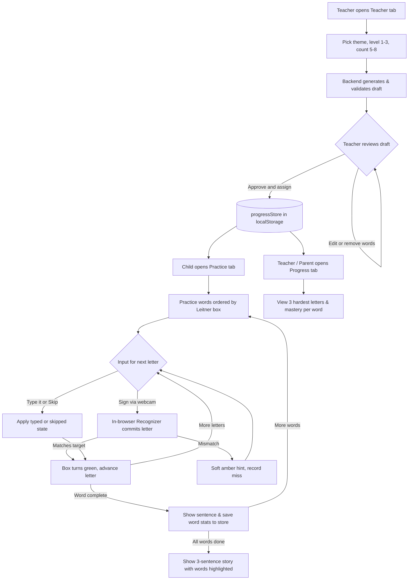
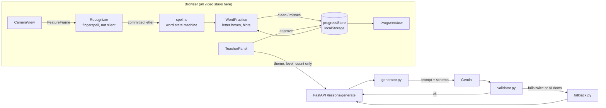

# Architecture

SignSteps combines SignSpeak's on-device ASL fingerspelling pipeline with a thin FastAPI lesson-generation backend. Video and child progress stay in the browser; only teacher dropdown selections (`theme`, `level`, `count`) cross the network.

## 1. User Flow Diagram

## 2. Technical Architecture Diagram

## 3. Recognition Pipeline (Reused Unchanged from SignSpeak)

1. **Capture & Landmarks (`src/input/CameraSource.ts`, `src/perception/*`):** Webcam frames are processed locally with `@mediapipe/tasks-vision` (hand, face, and pose landmarkers). `normalize.ts` produces a 178-dimensional `FeatureFrame` vector: left hand (`21 × 3 = 63`), right hand (`21 × 3 = 63`), and 52 face blendshapes, wrist-anchored and scale-invariant.
2. **Classifier (`src/recognition/classifier.ts`):** Loads `public/models/fingerspell_asl/model.json` and `labels.json` (`A`–`Z`, 26 classes). Slices the first 126 hand dimensions (`featureLen = 252` after `mean+std` aggregation across a sliding buffer of up to 30 frames, minimum 5 frames) and runs a 2-layer ReLU + softmax MLP (`252 → 128 → 26`) in TypeScript.
3. **Smoother (`src/recognition/smoothing.ts`, `src/recognition/recognizer.ts`):** `useWordSpeller.ts` instantiates `new Recognizer({ mode: 'fingerspell', silent: false, dwellMs, minConfidence })` (keeping `650 ms` / `0.6` defaults in `Recognizer` when omitted so `tools/golden.ts` remains unchanged). In SignSteps practice mode:
   - Vote window: `550 ms`
   - Minimum mean confidence: adjustable `40%`–`85%` (default `0.6` / `60%`)
   - Minimum vote share: `0.7` (prevents mid-transition miscommits, e.g., `S` before `A`)
   - Dwell to commit: adjustable `0.4 s`–`1.5 s` (default `800 ms` / `0.8 s`)
   - Release after low confidence / hand drop: `300 ms` (allows double letters such as `OO` in `BOOK`)
   - Running in `fingerspell`-only mode avoids the motion arbitration gate used in `both` mode, so `J` and `Z` remain available at Level 3.

## 4. Application Modules

### Frontend (`src/signsteps/` + `src/routes.tsx`)
- `src/routes.tsx`: `/` renders `SignStepsApp`.
- `src/signsteps/spell.ts`: Pure state machine (`startWord`, `applyLetter`, `skipLetter`, `isClean`, `countSignedLetters`, `queueRetry`, `OFFER_TYPE_AFTER = 3`).
- `src/signsteps/useWordSpeller.ts`: React hook feeding `CameraView` frames into `Recognizer` and updating `dwellMs` / `minConfidence` live via `recognizer.configure(...)`.
- `src/signsteps/WordPractice.tsx`: Child-facing word practice and 3-sentence story view; includes `aria-live="polite"` announcements, amber mismatch hints, type-instead input, skip button, hold-time/confidence/mirror controls, in-round retry for missed words, plural/possessive story highlighting, and per-word elapsed time (excluding model load time).
- `src/signsteps/TeacherPanel.tsx`: Teacher draft form (dropdown-only inputs), editable words, sentences, and 3-sentence story with live validation (`wordProblem`, `sentenceProblem`, `storyProblems`, duplicate check), and approval gate.
- `src/signsteps/ProgressView.tsx`: Child nickname + emoji avatar selector (`AVATARS`), top 3 hardest letters (`hardestLetters`), overall summary, and per-word attempts, clean spellings, word & letter accuracy, average time, and Leitner box (`1`–`4`).
- `src/signsteps/progressStore.ts`: Zustand store persisted in browser `localStorage` (`signsteps:progress:v1`), storing profile, active practice session across tab switches, practice settings (`holdMs`, `minConfidence`, `mirrored`), per-word timing/accuracy stats, and Leitner-box ordering (`practiceOrder`).
- `src/signsteps/lessonApi.ts`: Typed client for `/api/lessons/generate` (`60 s` browser timeout > `35 s` backend budget), shared client-side word/sentence/story validators, plural/possessive matcher (`matchesTargetWord`), and offline `STARTER_LESSON`.

### Backend (`backend/app/`)
- `backend/app/main.py`: FastAPI endpoints `GET /health` and `POST /lessons/generate` (Vite proxies `/api/*` to port `8000` in dev).
- `backend/app/schemas.py`: Pydantic v2 contracts (`LessonRequest`, `LessonWord`, `LLMLesson`, `Lesson`, literal `Theme` union).
- `backend/app/generator.py`: Builds prompt from dropdowns only, calls Gemini via `google-genai` (`response_mime_type="application/json"`, `response_schema=LLMLesson`, temperature `0.3`), retries transient errors with exponential backoff inside a `35 s` total budget while failing fast on permanent `4xx` errors (`400`/`401`/`403`/`404`), regenerates once with validator error feedback without leaking rejected-draft warnings onto accepted lessons, falls back on second failure or unavailability, and optionally populates `trace` telemetry separating network retries from draft regenerations.
- `backend/app/validator.py`: Deterministic rules enforcing `A`–`Z`, length `3`–`6` (L1/L2) / `3`–`8` (L3), no `J`/`Z` before L3, no double letters at L1, no duplicates, `<= 10` words per sentence, 3-sentence story covering every word, and static `BLOCKLIST` filtering.
- `backend/app/fallback.py`: Reviewed built-in 8-word lists and 3-sentence story builder for all 8 themes, verified valid across every `(theme, level, count)` combination.

## 5. Data & Privacy Boundary

| Store / Channel | What It Holds | Location |
| --- | --- | --- |
| Webcam stream & landmarks | Raw video frames, MediaPipe landmarks, 178-dim vectors | Browser memory only (never stored or transmitted) |
| `signsteps:progress:v1` | Nickname + emoji avatar (no real names), practice controls, approved lessons, word box/attempts/clean/time counts, letter miss counts | Browser `localStorage` |
| `POST /lessons/generate` | `{ theme, level, count }` request; `{ id, theme, level, words, story, source, warnings }` response | Browser ↔ Local FastAPI ↔ Gemini API |
